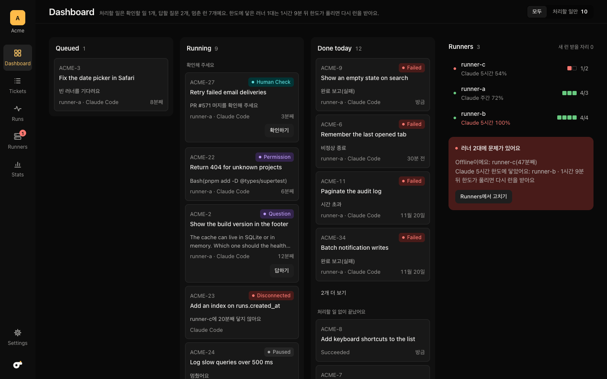
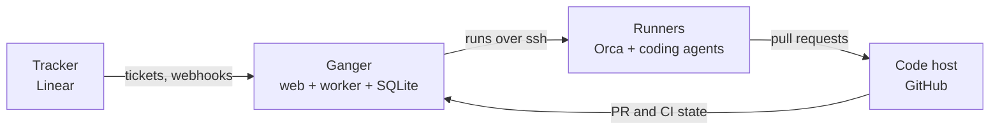

<p align="center">
  
  <br>
  
</p>

<p align="center">
  <a href="../../releases/latest">Download</a> ·
  <a href="docs/guide/self-hosting.md">Self-hosting</a> ·
  <a href="#documentation">Docs</a> ·
  <a href="CONTRIBUTING.md">Contributing</a>
</p>

# Ganger

Ganger is the foreman of your software factory: it hands tracker tickets to coding agents on your own runners and shows the status and statistics of every run.

It is a self-hosted tool for one operator. The server, your runners, and your data stay on machines you control.



## How it works



1. You label a ticket in your tracker or assign it in Ganger.
2. Ganger queues a run and starts an agent on a free runner.
3. The agent works and opens a pull request. Ganger shows its progress, questions, and result.

Terms such as run, runner, and workspace are defined in the [glossary](GLOSSARY.md).

## Features

- **Automatic assignment.** Tickets with the Auto-assign Label go to a free runner, in queue order.
- **One view of every run.** See what is queued, running, and done, and what needs you.
- **Stay in control.** Answer agent questions, handle permission requests, and cancel runs.
- **Runner health.** Track capacity, provider usage limits, GitHub authentication, and offline runners.
- **Stats.** Review how runs and tickets went over time.
- **Desktop app.** Get a tray icon, notifications, and automatic updates on macOS.
- **MCP server.** Let a local agent read Ganger's state and, when you allow it, act on it.

## Install

**Desktop app** (macOS, Apple silicon). Choose this for your laptop or to connect to a server you already run.

1. Download `Ganger-<version>-arm64.dmg` from [Releases](../../releases/latest).
2. Open the dmg and drag **Ganger** onto **Applications**.
3. Open Ganger and choose how to use it.

**Server bundle** (an always-on machine with Node 24). The bundle is not published, so you build it from a clone.

1. Build it with `pnpm install && pnpm build && pnpm bundle`, then copy `dist/ganger-<version>.tar.gz` to the machine.
2. Extract it and run `node ganger-<version>/cli/bin/cli.js init`.
3. Run the same CLI with `service install` to keep it running, or `start` to run it once.

The [self-hosting guide](docs/guide/self-hosting.md) covers each step and upgrades.

## First run

1. In the desktop app, run the server on this machine or connect to another server. With a server bundle, open `http://127.0.0.1:3000`.
2. Follow onboarding to connect your tracker and GitHub token, add a runner, and set up a workspace and its mapping.
3. Assign a ticket from Tickets, or add the Auto-assign Label to one in your tracker.

A webhook is optional. Without one, Ganger checks the tracker about once a minute. To get assignments within seconds, [turn on the webhook](docs/guide/networking.md#turn-on-the-webhook).

## Security

**The web app has no login.** Anyone who can reach its address can change settings and send commands to your runners. Keep it on `127.0.0.1` or a trusted private network such as a Tailscale tailnet, and expose only the webhook path (`/api/webhooks/`) to the internet. See [Networking and webhooks](docs/guide/networking.md).

## Documentation

| Guide                                               | What it covers                                        |
| --------------------------------------------------- | ----------------------------------------------------- |
| [Desktop app](docs/guide/desktop.md)                | Install, first launch, choosing a setup, and updates  |
| [Self-hosting](docs/guide/self-hosting.md)          | Server bundle, setup, upgrades, and running a service |
| [Configuration](docs/guide/configuration.md)        | Installation folder, `.env`, variables, and sleep     |
| [Networking and webhooks](docs/guide/networking.md) | Web address, host checks, Funnel, and tunnels         |
| [Runners](docs/guide/runners.md)                    | Adding Macs and pull request title rules              |
| [MCP](docs/guide/mcp.md)                            | Tools, write access, and client configuration         |
| [Troubleshooting](docs/guide/troubleshooting.md)    | Server logs and the diagnostics bundle                |
| [Releasing](docs/releasing.md)                      | Release flow and repository setup for maintainers     |

## Contributing

You need Node 24 and the pnpm version in `package.json`. This starts the desktop app with fake adapters and sample data, so it needs no accounts:

```sh
nvm use
pnpm install
pnpm dev
```

Read [CONTRIBUTING.md](CONTRIBUTING.md) for the structure, commands, and checks. Coding agents should start with [AGENTS.md](AGENTS.md). Key decisions are in [`docs/adr/`](docs/adr/), and the artwork rules are in the [brand guide](packages/ui/brand/README.md).

## License

[MIT](./LICENSE)
